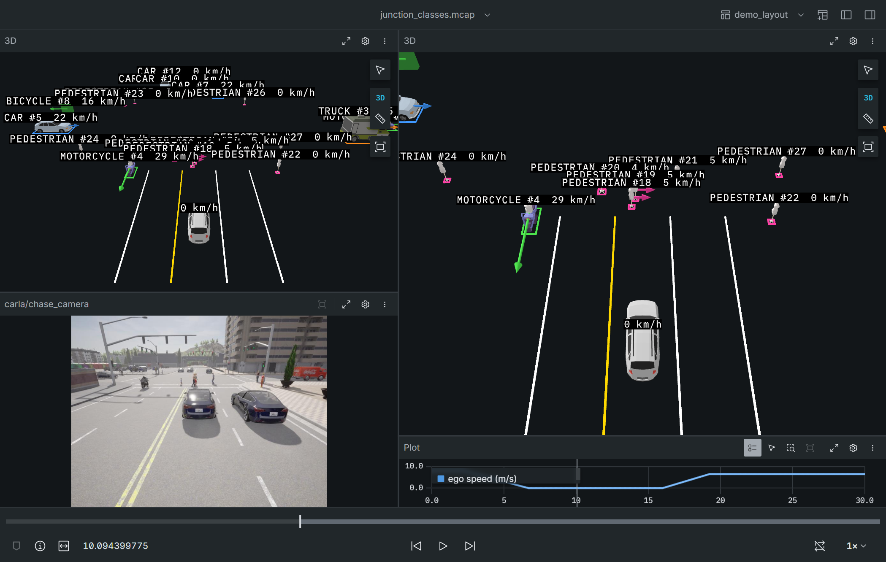

# ADAS Foxglove Viewer

This is a small add-on (an *extension*) for the Foxglove app. Open a
recording (`.mcap`) and it draws, in a 3D view, what the car perceived:

- the **objects** around the car, as 3D models (car, truck, pedestrian,
  motorcycle with rider) or boxes, each with an arrow showing where it is
  moving and a label with its class and speed;
- the **lane lines**;
- the **ego car** itself, with its speed above it.

The view moves with the ego car. Next to it you see the camera video and a
speed plot, both drawn by Foxglove itself.



## Before a demo

- [ ] **Dark theme.** *Profile menu (top right) -> Settings -> Appearance ->
  Color scheme -> Dark.* White lane lines and labels are hard to read on the light theme.
- [ ] **Timestamp format in seconds.** Same page, *Visualization timestamp
  format -> Seconds*, so the time bar shows `11.7` rather than a 1970 date.
- [ ] **`demo_layout` imported and selected** (see below). It must be the 0.4.0 file with two 3D panels: delete an older `demo_layout` first (layout menu -> right-click it -> Delete), then import `layouts/demo_layout.json`.
- [ ] **Both junction recordings are on the laptop:** `samples/junction_classes.mcap` and `samples/junction_unclassified.mcap` (not in git; copy them).
- [ ] **Extension version 0.4.0** shown under *profile menu -> Extensions*.

## Set up the demo laptop (once)

1. **Install Foxglove desktop** from <https://foxglove.dev/download> and sign in.
2. **Install the extension.** Drag `adas.foxglove-viewer-0.4.0.foxe` onto the
   Foxglove window. Check it under *profile menu (top right) -> Extensions*:
   "ADAS Foxglove Viewer" should be listed.
   - **Updating to a new `.foxe`?** First remove the old one: *Extensions ->
     ADAS Foxglove Viewer -> Uninstall*. Then drag in the new file and
     restart Foxglove (or press `Ctrl+R`).
3. **Import the layout.** Click the layout name at the top right ->
   *Import from file…* -> pick `layouts/demo_layout.json`. A layout called
   `demo_layout` appears and becomes active.

## Run the demo

1. *Dashboard -> Open local file(s)* and pick a recording, such as
   `samples/bsd_passby_dv16.mcap`. Allow file access if Foxglove asks.
2. Make sure the layout at the top right says `demo_layout`.
3. Press play (or drag the time bar at the bottom).

The layout has four panels. Top left is the **chase 3D view**, seen from behind
and above the ego car. Below it is the camera video (`carla/chase_camera`).
The large panel on the right is a **second 3D view from high above (BEV)**, and
below it the ego speed over time. Both 3D views follow the ego car.

## Junction demo

Two 30 s recordings of the same signalised four-way junction (simulated in
CARLA, Town05): `samples/junction_classes.mcap` (true classes) and
`samples/junction_unclassified.mcap` (every object class written as
`UNCLASSIFIED`). The ego car approaches, stops at the red light, waits, goes on
green and crosses. Cross traffic has cars, one truck, two motorcycles and one
cyclist; pedestrians use the crosswalks. Open `junction_classes.mcap` first.

**The BEV panel** looks down from 28 m, tilted 40 degrees so that a label floats
above its object instead of hiding it (see Known limits), centred 8 m ahead of the ego car.

**Presenter script (about 2 minutes).**

1. **0:00-0:20, the picture.** "Left is the chase view, right is from above, the video is the
   camera. The white car is us, the number above it is our speed." Press play.
2. **0:20-0:45, waiting at red (play to about 7 s, then pause or let it run).** Point at the speed
   text reading 0 km/h and the red light in the video. "We are stopped at the light."
3. **0:45-1:10, the crosswalk (about 8-14 s).** In the BEV, point at the small pink footprints
   ahead of us: pedestrians. "Each pedestrian is a class, a number and a speed. The arrow shows
   which way they walk." Then the cross traffic: blue is a car, orange the truck, green a motorcycle
   (with a rider) or the cyclist (a box), pink a pedestrian.
4. **1:10-1:30, go (about 16-22 s).** "Green: we move off." The speed text and the plot rise.
   Point at the cars passing in front. The lane lines vanish (about 17-23 s): "no lane lines
   inside the junction. That is by design, the recording has none there."
5. **1:30-1:45, flip to cuboids (pause at about 10 s).** In **each** 3D panel: gear icon ->
   *Topics* -> untick `objects`, tick `objects_boxes`. "This is what the sensor reports: boxes,
   no model." Swap back the same way (tick `objects`, untick `objects_boxes`).
6. **1:45-2:00, unknown classes.** Open `junction_unclassified.mcap` (*Dashboard -> Open
   local file(s)*, or drag it in), same layout. "Same traffic, but the sensor did not tell us
   the class. Every object is a grey box labelled UNCLASSIFIED: the fallback is automatic,
   nothing to set."

**Honest limits to say out loud.**

- Lane lines end at the junction on purpose (about 17-23 s, and the last 0.15 s).
- Only objects the front sensor sector lists are drawn; nothing beside or behind the ego car.
- Pedestrians are small: a 0.4 m footprint. The model is a torso on a stand (no head), and
  the motorcycle rider is the same torso. In the BEV they show as small pink footprints with a torso; say so
  and point at them.
- The scene is simulated; the traffic lights and crosswalks are visible only in the video, not drawn in 3D.

## What you see

| Class | Drawn as | Colour (outline, box, arrow) | Hex |
|---|---|---|---|
| CAR | 3D car model | blue | `#4099ff` |
| TRUCK | 3D truck model | orange | `#ff8c1a` |
| PEDESTRIAN | 3D mannequin model | pink | `#ff40a6` |
| MOTORCYCLE | 3D motorcycle model with a mannequin rider | green | `#4de64d` |
| BICYCLE | box | green | `#4de64d` |
| Any other class (point, wide, unclassified, other vehicle, multiple, traffic light, unknown) | box | grey | `#b3b3b3` |
| Ego car | 3D SUV model | its own colours | |

| What | Colour | Hex |
|---|---|---|
| White lane marking | white | `#ffffff` |
| Yellow lane marking | yellow | `#ffd900` |
| Lane marking of unknown colour | light grey | `#bfbfbf` |
| Road edge | dark grey | `#595959` |

*This table is printed by `npx vite-node scripts/colour_table.ts` from the
values in `src/style.ts`. Rerun it and paste the output here if a colour changes.*

- **Models and boxes.** A model keeps its own colours; the class colour is the
  **outline** drawn on the ground around it (the box the sensor reported).
  Boxes are see-through. A small **ball** marks an object whose size is unknown.
- **Fallback, per object.** An object whose class has a model and whose box is
  valid is drawn as that model. If the class has no model it is a box, and if
  the box is not valid it is a ball. Nothing needs configuring: a sensor that
  sends `UNCLASSIFIED` simply gets boxes.
- **Boxes only switch.** To see everything as boxes, as the sensor reports it:
  open the 3D panel settings (gear icon) -> *Topics*, untick `objects` and tick
  `objects_boxes`. Swap back to return. The topic `objects_boxes` is added by
  the extension when the recording has a topic named `objects`.
- **Arrow**: it starts at the middle of an object and points where the object
  is moving over the ground. A longer arrow means a faster object
  (0.5 m of arrow per m/s, at most 15 m). Objects slower than 0.5 m/s get no arrow.
- **Label** above each object: class, the object's number in this recording,
  and its speed over the ground, for example `CAR #1  88 km/h`. When the sender
  filled the class confidence (a value above 0) it follows the class, as the raw
  number, for example `PEDESTRIAN conf 87  #3  5 km/h`. Without it (0 or absent)
  the label is as before.
- Models are CC0 (public domain), by Quaternius (car, truck, SUV), reyshapes (mannequin) and AliceCassie (motorcycle); sources and checksums in `assets/ASSETS.md`.
- Model heights: car 1.5 m, truck 3.4 m, pedestrian 1.75 m, motorcycle with rider 1.5 m, bicycle 1.7 m, other 1.6 m (box).
- **Text above the ego car**: the ego speed in km/h.
- A **faded lane line** was predicted, not measured, in this frame.
  A fully opaque line was measured.

## Known limits

- **Class confidence has no confirmed unit.** The label shows the raw number after `conf`, never a percent sign.
- **Heights are per class, not measured.** The recordings carry no object height; length, width and heading come from the recording.
- **Ego-fixed view only.** The ego car stays in the middle and the world moves
  past it. There is no map and no driven path.
- The ego car is drawn 4.5 x 1.8 x 1.5 m, each axis scaled from the model. The size is not read from the recording.
- The pedestrian model is a torso on a stand, and the models are low-poly. A pedestrian box is about 0.4 m across, so a
  pedestrian is small in a top-down view. In a straight-down orthographic view the text label sits exactly on top of
  the pedestrian and hides it, so the BEV is tilted (perspective, 40 degrees).
- **Only these recordings work:** ones whose topics use the
  `adas.perception.DfObjList` (objects), `adas.perception.RoadModel` (lanes)
  and `adas.common.VehDyn` (ego speed) schemas. Topic names do not matter.
- Recordings made before 2026-10-27 may show `Error in topic truth/actors` in
  the *Problems* tab. That topic is not used by the viewer and the error can be ignored.

## Rebuild the `.foxe` (developers)

In WSL, from this folder:

```sh
export PATH=$HOME/.local/node-v20.18.0-linux-x64/bin:$PATH
npm ci            # clean install of the pinned dependencies
npm test          # unit tests of the converters
npm run package   # writes adas.foxglove-viewer-<version>.foxe here
```

3D models: see `assets/ASSETS.md` (CC0; Quaternius, reyshapes, AliceCassie). To change a model, run
`py -3 scripts/measure_glb.py assets/<file>.glb`, put the numbers in `src/style.ts`, then
`py -3 scripts/gen_models.py`.

The code lives in `src/`. `src/convert/*.ts` turns each message type into
3D shapes, and every size and colour is a named value in `src/style.ts`. The
design and build order are in `docs/plan.md`.
